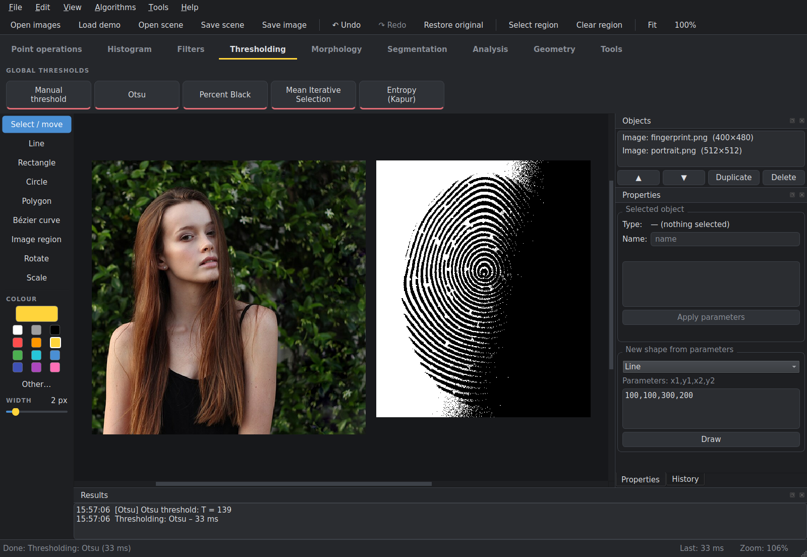

# BioGrafix

A desktop toolkit for biometric image processing and computer graphics: thresholding, filters,
morphology, histograms, colour models and vector shapes, all on one canvas.

🇵🇱 [Wersja polska](README.pl.md)



## Features

- Images and shapes on one canvas, results side by side.
- Algorithm ribbon: one tile per algorithm, parameters in a small dialog.
- Undo / redo with a full step history.
- Background processing with a live timer and cancel.
- Region of interest: run any operation on a selected area only.
- Drawing tools: Bresenham lines, rectangles and circles, polygons, Bézier curves.
- English and Polish interface (View → Language).

## Algorithms

| Category | What's inside |
|---|---|
| Point operations | add / multiply / divide, brightness, levels, lighten / darken, 5 grayscale methods, fill with colour |
| Histogram | luminance and RGB histograms, stretching and equalisation (luminance / per channel) |
| Filters | box blur, Gaussian 5×5, median, Sobel magnitude, sharpen, custom kernel, preset kernels (Prewitt, Sobel, Laplace, corners) |
| Thresholding | manual, Otsu, Percent Black, Mean Iterative Selection, entropy (Kapur) |
| Morphology | dilation, erosion, opening, closing, hit-or-miss (thinning / thickening) |
| Segmentation | background removal (rembg) |
| Analysis | colour coverage in HSV |
| Geometry | translate, rotate, scale (homogeneous matrices), Bézier degree elevation |
| Tools | RGB ↔ CMYK converter, 3D RGB cube, 3D HSV cone |

Files: PNG, JPEG (with quality setting), BMP, TIFF, PPM (P3/P6). The whole scene can be saved as JSON.

## Getting started

Python 3.12 or newer.

**Windows (PowerShell)**
```powershell
python -m venv .venv-win
.venv-win\Scripts\python.exe -m pip install -r requirements.txt
.venv-win\Scripts\python.exe main.py
```

**Linux / WSL**
```bash
python3 -m venv .venv-wsl
source .venv-wsl/bin/activate
pip install -r requirements.txt
python main.py
```

Use a separate virtual environment per system: a Windows venv does not work in WSL and vice versa.
Images can be passed on the command line: `python main.py fingerprint1.png fingerprint2.png`.

**Load demo** (Ctrl+Shift+D) opens a sample portrait and a synthetic fingerprint.

## Tests

```bash
python -m unittest discover -s tests -t .
```

## Project layout

```
main.py              entry point
biografix/
  algorithms/        pure algorithms, no GUI
  operations/        registers algorithms as tiles and menu entries
  core/              registry, parameters, document + undo history, background runner
  scene/             scene objects, JSON save / load
  io/                image reading and writing (incl. PPM)
  resources/         demo images
  ui/                main window, ribbon, themes, canvas, panels, tool windows
docs/                screenshots
tests/
```

An algorithm is a plain function registered with the `@operation` decorator; its tile, parameter dialog,
background execution and undo step are generated from that declaration.

## Credits

Demo portrait: photo by [Christopher Campbell](https://unsplash.com/photos/3hoAon9Mc88) (CC0).
The demo fingerprint is synthetic.
